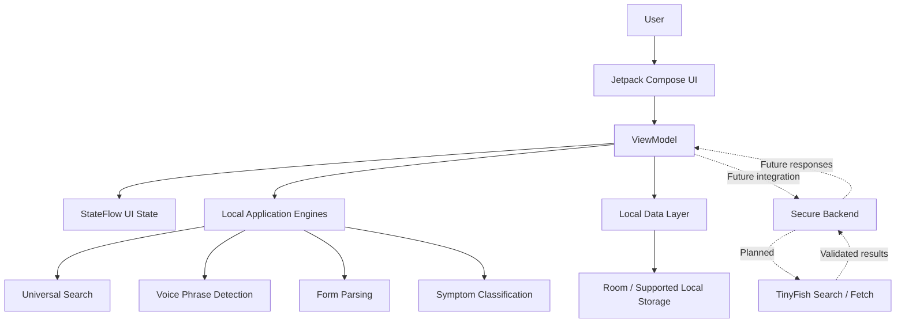

# 🇮🇳 Sahayak Delhi

### One trusted front door to urgent civic and care services.

<p align="center">
  <strong>An Android application concept bringing essential support, health guidance, emergency assistance, and everyday civic services into one accessible experience.</strong>
</p>

<p align="center">
  
  
  
  
  
</p>

<p align="center">
  <a href="https://github.com/jayantverma5543-cmyk/Sahayak-Delhi">Repository</a>
  •
  <a href="#-features">Features</a>
  •
  <a href="#-getting-started">Getting Started</a>
  •
  <a href="#-architecture">Architecture</a>
  •
  <a href="#-roadmap">Roadmap</a>
</p>

---

## 📌 About the Project

**Sahayak Delhi** is an Android application project designed around a simple idea: people should not have to navigate multiple disconnected apps and services when they need help.

Whether someone needs emergency assistance, information about nearby healthcare, basic first-aid guidance, a water tanker, or educational counselling, Sahayak Delhi aims to provide a single, straightforward starting point.

The project combines a modern Android interface with locally implemented search, voice phrase detection, form parsing, symptom-keyword classification, and a foundation for future AI-assisted and live-web capabilities.

Built with **Kotlin and Jetpack Compose**, Sahayak Delhi is being developed with accessibility, practical workflows, modularity, and future extensibility in mind.

> **Project focus:** Make essential services easier to discover and everyday help easier to access.

## 🎯 The Problem

Finding the right service can be difficult when information is spread across different platforms, websites, phone numbers, and manual processes.

- 🚨 **Urgent situations:** People need a clear way to access emergency-related actions.
- 🏥 **Healthcare discovery:** Finding appropriate healthcare information can take time.
- 🩹 **First-aid information:** People need understandable preliminary guidance while seeking appropriate care.
- 🚰 **Civic services:** Everyday needs, such as requesting a water tanker, can involve fragmented workflows.
- 🎓 **Educational guidance:** Students may struggle to find suitable counselling resources.
- 🔎 **Fragmented discovery:** Switching between different sections and services creates unnecessary friction.

### 💡 The proposed solution

Sahayak Delhi brings these use cases together in one Android application, with a shared interface, reusable components, local application logic, and a foundation for connecting future external data sources.

## ✨ Features

### 🚨 1. Emergency and SOS experience
- Emergency-oriented entry points designed for quick access.
- Voice phrase detection for supported SOS-related phrases.
- A foundation for improving emergency workflows and response handling.

**Important:** Voice phrase detection is not the same as a verified emergency dispatch service. Users should contact the appropriate local emergency service directly when necessary.

### 🏥 2. Healthcare discovery
- Hospital and clinic discovery workflows.
- Doctor-related service discovery.
- A foundation for making healthcare information easier to navigate.

Availability, distance accuracy, live listings, and appointment booking depend on the data sources and integrations implemented.

### 🩹 3. First-aid and symptom guidance
- Keyword-based symptom classification.
- Rule-based preliminary guidance logic.
- A starting point for clearer, more accessible health-information workflows.

**Health disclaimer:** Sahayak Delhi is not a medical diagnostic tool and does not replace a qualified healthcare professional. Symptom matching may be incomplete or incorrect. For severe or rapidly worsening symptoms, seek urgent medical care.

### 🚰 4. Water tanker assistance
- Water tanker-related service discovery and request workflows.
- A foundation for connecting civic service information to a unified interface.

Actual submission, provider availability, request tracking, and fulfilment require appropriate service integrations.

### 🎓 5. Educational counselling
- An educational counselling discovery use case.
- A foundation for making guidance resources easier to access.

### 🔎 6. Universal search
- A unified search entry point across supported service categories.
- Local routing logic that identifies likely destinations from search terms.
- A foundation for extending search to live external sources.

### 📝 7. Smart form assistance
- Local form-parsing logic.
- Pattern-based extraction for supported information.
- A foundation for reducing repetitive manual input.

### 👤 8. Saved profiles and autofill foundations
- Profile-related workflows intended to reduce repeated entry.
- Reusable data-handling foundations for supported forms.

### 🔊 9. Voice phrase detection
- Local phrase matching for supported voice/SOS-related workflows.
- A starting point for more flexible, natural-language interaction.

Voice recognition, phrase matching, and automatic emergency actions are distinct capabilities; supported behavior depends on the implementation and device permissions.

### 🔐 10. Security-conscious storage
- An encrypted-storage implementation for supported sensitive settings.
- A foundation for handling configuration data more carefully.

Encryption does not automatically secure every form of application data. Storage, logging, network transport, and backend handling must each be assessed separately.

---

## 🛠️ Tech Stack

| Technology | Purpose |
|---|---|
| **Kotlin** | Primary Android application language |
| **Jetpack Compose** | Declarative UI development |
| **ViewModel** | UI state and lifecycle-aware application logic |
| **StateFlow** | Observable state management |
| **Room** | Local persistence foundation |
| **Gradle Kotlin DSL** | Android project build configuration |
| **EncryptedSharedPreferences** | Encrypted storage for supported settings |
| **Local rule-based engines** | Search routing, phrase matching, form parsing, and heuristic classification |
| **TinyFish API integration (planned)** | Potential live-web search and fetch capabilities |

> The technologies listed describe the project's implementation foundations. The exact dependency versions and the implementation status of individual integrations should be checked in the source files before making compatibility or production-readiness claims.

## 🧠 AI/ML and TinyFish Integration

Sahayak Delhi explores how local application logic can work alongside external web-data capabilities.

The current source includes locally implemented engines and heuristic logic for supported workflows. The TinyFish-related classes provide a foundation for extending these capabilities.

### Current implementation vs. future integration

| Capability | Status |
|---|---|
| Local search routing | Implemented in supported workflows |
| Voice phrase matching | Implemented for supported phrases |
| Pattern-based form parsing | Implemented for supported inputs |
| Keyword-based symptom classification | Implemented as heuristic logic |
| Rule-based example alerts | Implemented in local logic |
| Encrypted API-key storage foundation | Present in the source |
| Verified live TinyFish Search API requests | Not yet verified in the source |
| Verified live TinyFish Fetch API requests | Not yet verified in the source |
| Production-grade external AI inference | Requires implementation and validation |

### 🔗 Proposed TinyFish workflow

The intended future architecture could use external search and fetch capabilities to retrieve relevant information, then process the results into useful service information.

1. A user searches for a service or asks a supported question.
2. The application sends an appropriately scoped request to a secure backend.
3. The backend calls the configured external search or fetch service.
4. Retrieved information is validated and transformed into a consistent response.
5. The application displays the result with appropriate source information and limitations.

This workflow is a **proposed integration**, not a claim that live TinyFish requests are already working.

**Useful references:**
- [TinyFish](https://www.tinyfish.ai/)
- [TinyFish Search](https://future.tinyfish.io/search)
- [TinyFish Fetch](https://future.tinyfish.io/fetch)
- [TinyFish Search & Fetch information](https://www.tinyfish.ai/free-search-fetch)

API availability, authentication requirements, endpoint formats, usage limits, and response schemas should be confirmed against the provider's current documentation.

## 🏗️ Architecture

The application is organized around the Android UI, state management, local data handling, and reusable logic components.



*The dashed connections represent proposed future integrations, not confirmed live functionality.*

### Architecture principles

- **Separation of concerns:** Keep presentation, state management, and application logic organized.
- **Reactive UI:** Use observable state for UI updates where implemented.
- **Reusable logic:** Keep supported parsing, routing, and classification operations in reusable components.
- **Local-first foundations:** Use local logic and storage for supported workflows.
- **Secure integration design:** Route future external API calls through a backend instead of embedding private credentials in the Android app.
- **Incremental extensibility:** Add and validate external integrations without treating planned capabilities as finished features.

## 📂 Repository Structure

The repository is the **Android application source code**. It includes the Gradle project configuration and application source.

```text
Sahayak-Delhi/
├── app/
│   └── src/
│       └── main/
│           ├── java/              # Kotlin application source
│           ├── res/               # Android resources
│           └── AndroidManifest.xml
├── gradle/                        # Gradle wrapper configuration
├── .env.example                   # Example environment configuration, if applicable
├── .gitignore
├── build.gradle.kts               # Root build configuration
├── gradle.properties
├── settings.gradle.kts
├── metadata.json
└── README.md
```

*This is a high-level guide, not a guarantee that every listed file or directory has the same contents in every revision. Explore `app/src/main/` to find the exact package and source layout in the checked-out version.*

### Important source components

The codebase includes TinyFish-named components for local application logic, including:

- `TinyFishVoiceSosDetector` — supported voice/SOS phrase matching.
- `TinyFishFormParser` — pattern-based form parsing.
- `TinyFishSymptomClassifier` — heuristic symptom classification.
- `TinyFishUniversalSearch` — local search routing.
- `TinyFishPredictiveEngine` — rule-based predictive or alert logic.
- `TinyFishSecureStorage` — secure storage for supported settings.
- `TinyFishModelImpl` — model-related logic and runtime foundation.

Names containing “TinyFish” should not be interpreted as proof that those classes currently call a live TinyFish API or run a trained machine-learning model. Check each implementation before relying on it.

## 🚀 Getting Started

### Prerequisites

Before building the app, prepare the following:

- A computer running Windows, macOS, or Linux.
- [Android Studio](https://developer.android.com/studio).
- A compatible JDK as required by the project's Gradle and Android Gradle Plugin versions.
- Android SDK components required by the project.
- An Android emulator or a compatible physical Android device.
- Git, if cloning the repository through the command line.

### 1. Clone the repository

```bash
git clone https://github.com/jayantverma5543-cmyk/Sahayak-Delhi.git
```

```bash
cd Sahayak-Delhi
```

### 2. Open the project

1. Launch Android Studio.
2. Select **Open**.
3. Choose the cloned `Sahayak-Delhi` directory.
4. Allow Gradle synchronization to finish.
5. Install any SDK components requested by Android Studio.

### 3. Run the application

1. Select an Android emulator or connect a physical device.
2. Wait for indexing and Gradle synchronization to finish.
3. Select the app run configuration.
4. Click **Run**.

If the project does not build, review the Gradle error output and confirm that your JDK, Android SDK, and installed build tools are compatible with the versions configured by the repository.

### 4. Build from the terminal

On Windows Command Prompt:

```bat
gradlew.bat assembleDebug
```

On macOS or Linux:

```bash
chmod +x gradlew
./gradlew assembleDebug
```

These commands assume the Gradle wrapper scripts are present in the cloned repository. If they are missing, open the project in Android Studio and verify the repository's build configuration before generating a wrapper.

## 🔑 Configuration and API Keys

The source includes a foundation for storing a supported API key securely. Live external requests still require a correctly implemented and tested integration.

For a future TinyFish integration:

1. Obtain credentials directly from the provider.
2. Confirm the current endpoint, authentication method, request format, and response schema.
3. Keep private API keys on a trusted backend.
4. Let the Android app call your backend using authenticated HTTPS requests.
5. Validate responses, handle errors, and apply appropriate timeouts and rate limits.
6. Avoid logging secrets, tokens, or sensitive user data.

### ⚠️ Never commit secrets

Do not commit real API keys, access tokens, passwords, private signing keys, or production credentials to GitHub.

An `.env.example` file should contain **placeholder values only**. An environment file does not automatically configure an Android app or protect a secret bundled inside an APK.

## 🧪 Testing and Validation

Before using the app for real-world workflows, test the relevant behavior on supported Android versions and devices.

Recommended validation areas:

- [ ] App launches successfully.
- [ ] Main navigation and supported screens render correctly.
- [ ] Search handles empty, unknown, and valid queries.
- [ ] Voice-related features handle unsupported phrases safely.
- [ ] Form parsing handles missing and malformed input.
- [ ] Symptom classification communicates its limitations.
- [ ] Local data behaves correctly across app restarts.
- [ ] Permission denial and unavailable device features are handled.
- [ ] Sensitive settings are not exposed through logs or repository commits.
- [ ] Network failures and invalid API responses are handled before enabling external integrations.
- [ ] Emergency-related UI does not falsely imply that assistance has been dispatched.

Run any available tests from Android Studio or use the Gradle test tasks supported by the project.

## 🔒 Privacy, Security, and Responsible Use

Sahayak Delhi covers use cases that may involve sensitive information, so responsible implementation matters.

- Request only the permissions required by a feature.
- Explain why sensitive information is needed.
- Avoid collecting unnecessary personal or health information.
- Use secure transport for network communication.
- Store sensitive information only when necessary and with appropriate safeguards.
- Keep API credentials outside public source code and client-side bundles.
- Clearly distinguish local examples from verified live data.
- Do not present keyword matching as a medical diagnosis.
- Do not claim emergency dispatch, service fulfilment, or successful booking without confirmation from the relevant service.

**This project is a developing software application, not a certified emergency-response system or medical device.** Users should verify service information and contact appropriate professionals or emergency services directly when needed.

## 🗺️ Roadmap

The following are development goals, not promises that the functionality is already available.

- [ ] Complete end-to-end validation of existing Android workflows.
- [ ] Improve search relevance, empty states, and error handling.
- [ ] Expand accessibility, responsive layouts, and usability testing.
- [ ] Add automated tests for supported parsing and routing logic.
- [ ] Complete and validate Room persistence for the intended data flows.
- [ ] Implement a secure backend for external service integrations.
- [ ] Integrate TinyFish Search and Fetch using verified API contracts.
- [ ] Add source attribution, freshness indicators, and validation for retrieved information.
- [ ] Improve observability without exposing sensitive data.
- [ ] Test performance and compatibility across Android devices.
- [ ] Document release, deployment, and privacy practices before production use.

## 🖼️ Screenshots and Demo

Screenshots make it easier for contributors and reviewers to understand the app without building it first.

Add genuine screenshots from your running application to a folder such as `docs/screenshots/`, then reference them here.

Example Markdown to use after adding a real screenshot:

```markdown

```

Recommended screenshots:

- Home screen and navigation.
- Universal search.
- Healthcare discovery.
- First-aid or symptom guidance.
- Water tanker or counselling workflow.
- Profile and supported settings screens.

Only add screenshots that match the current application. Do not use concept art as evidence of implemented UI or functionality.

## 🤝 Contributing

Contributions, suggestions, testing feedback, and code improvements are welcome.

### How to contribute

1. Fork the repository.
2. Create a branch for your change.
3. Implement and test your changes.
4. Keep changes focused and follow the existing project structure.
5. Review your diff for accidental secrets or unrelated files.
6. Submit a pull request describing the problem, solution, and testing performed.

Example:

```bash
git checkout -b feature/your-feature
```

```bash
git add .
git commit -m "feat: describe your change"
git push origin feature/your-feature
```

Then open a pull request from your fork.

### Contribution guidelines

- Write clear, maintainable Kotlin.
- Keep UI code and application logic separated where practical.
- Avoid introducing unnecessary dependencies.
- Never commit real credentials or private user data.
- Document new permissions, configuration, and external integrations.
- Be explicit about whether a feature is implemented, experimental, or planned.
- Include reproducible steps when reporting bugs.

## 🐛 Reporting Issues

When opening an issue, include as much useful information as possible:

- A clear description of the problem.
- Steps to reproduce it.
- Expected and actual behavior.
- Android version and device/emulator details.
- Relevant error messages or sanitized logs.
- Screenshots, if useful.

**Never include API keys, passwords, personal medical details, or other private information in an issue.**

## 🧑‍💻 Maintainer

**Project:** Sahayak Delhi  
**Repository:** [jayantverma5543-cmyk/Sahayak-Delhi](https://github.com/jayantverma5543-cmyk/Sahayak-Delhi)  
**Development context:** Kritical Hacks'26 — AI/ML track

For bug reports, feature requests, and technical discussion, please use the repository's GitHub Issues and Pull Requests.

## 📄 License

No license has been confirmed for this repository in this README.

Before publishing the project for reuse, add a `LICENSE` file with the license you choose. Until then, do not assume that others have permission to redistribute or modify the source code merely because it is publicly visible on GitHub.

## 🙌 Acknowledgements

- **Android and Kotlin** for the application development ecosystem.
- **Jetpack Compose** for declarative Android UI development.
- **The open-source community** for tools, learning resources, and inspiration.
- **TinyFish** as a potential external search/fetch integration, subject to implementation and validation.
- **Kritical Hacks'26** as the project development context.

---

<p align="center">
  <strong>Built with purpose. Designed around access. Evolving toward a more connected Delhi.</strong>
</p>

<p align="center">
  🇮🇳 <em>Sahayak Delhi — One place to start when you need help.</em>
</p>
